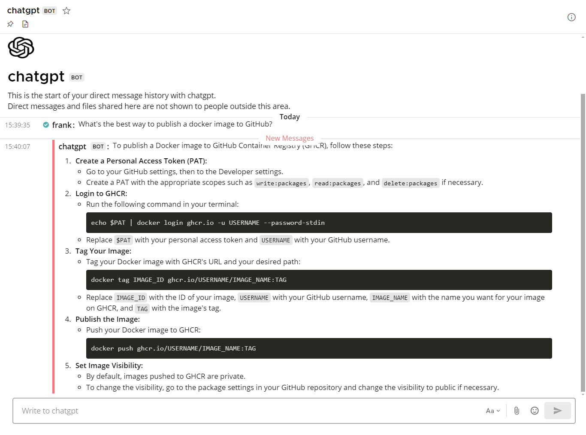

[](https://github.com/Elehiggle/OpenAIo1MattermostChatbot/stargazers)
[](https://github.com/Elehiggle/OpenAIo1MattermostChatbot/actions/workflows/docker-publish.yml)
[](https://github.com/Elehiggle/OpenAIo1MattermostChatbot/commits/master)
[](https://github.com/Elehiggle/OpenAIo1MattermostChatbot/blob/master/LICENSE)

# OpenAIo1MattermostChatbot

> [!WARNING]
> **Archived and unmaintained — October 25, 2026**
>
> This project is no longer maintained. No further bug fixes, dependency updates, security patches, or support will be provided.
>
> GitHub Dependabot reports unresolved dependency vulnerabilities, including a critical-severity alert. **Do not deploy this project or its existing container images.** Migrate or retire existing installations.

## Alternatives

- **[Mattermost Agents](https://github.com/mattermost/mattermost-plugin-agents)** — the official Mattermost AI integration, formerly Copilot. Supports OpenAI, Anthropic, and OpenAI-compatible providers. Requires administrator configuration; check [server compatibility in the releases](https://github.com/mattermost/mattermost-plugin-agents/releases) and [license/feature requirements](https://docs.mattermost.com/administration-guide/configure/agents-admin-guide). See the [provider guide](https://docs.mattermost.com/agents/docs/providers).
- **[nanobot](https://github.com/HKUDS/nanobot)** — a standalone, self-hosted Python agent with a [built-in Mattermost integration](https://github.com/HKUDS/nanobot/blob/main/docs/guides/mattermost-ai-agent.md) and [OpenAI, Anthropic, and DeepSeek providers](https://github.com/HKUDS/nanobot/blob/main/docs/providers.md). Review its file/shell tool permissions and Mattermost access controls before deployment.

For this OpenAI-based bot, review the OpenAI provider configuration in either alternative. The historical o1-preview configuration below is not a current model recommendation.

These are migration options, not drop-in replacements. Migration requires new configuration. Feature parity, including URL extraction, YouTube transcripts, image generation, or custom emoji support, is not guaranteed.

The documentation below is retained for historical reference, not as current deployment guidance.

---



This project is a chatbot for Mattermost that integrates with the OpenAI API to provide helpful responses to user messages. The chatbot - like this readme - is mostly written by **Claude 3 AI**, listens for messages mentioning the chatbot or direct messages, processes the messages, and sends the responses back to the Mattermost channel.

## Historical model configuration

The model names and preview-era limitations below describe the retired implementation and may no longer apply. Use the current provider documentation linked under [Alternatives](#alternatives) when migrating.

## Features

- **Responds to messages** mentioning "@chatbot" (or rather the chatbot's username) or direct messages
- Extracts **images, PDFs and other files** from message attachments and from **URL links** in messages
- Supports **FlareSolverr** to bypass Javascript/CAPTCHA restrictions
- **Gets transcripts of YouTube videos** for easy tl;dw summarizations. Title, description and uploader are also
  provided
- Maintains context of the conversation within a thread
- Sends typing indicators to show that the chatbot is processing the message
- Utilizes a thread pool to handle multiple requests concurrently (due to `mattermostdriver-asyncio` being outdated)
- Offers **Docker support** for easy deployment

## Prerequisites

- Python 3.11 or just a server with [Docker](https://docs.docker.com/get-started/) _(you can get away with using 3.8 if
  you use datetime.datetime.utcnow() instead of datetime.datetime.now(datetime.UTC))_
- OpenAI API key
- Mattermost Bot token (alternatively personal access token or login/password for a dedicated Mattermost user account for the chatbot)
- The bot account needs to be added to the team and to the channels you want it to watch

## Installation

1. Prepare a Mattermost bot account token and OpenAI API key

    - Create an OpenAI API key [here](https://platform.openai.com/api-keys)
    - Create a Mattermost bot account token directly in the chat: _Left menu -> Integrations -> Bot accounts_. Give it
      the post:channels permission (this also suffices for DMs)

2. Clone the repository:

    ```bash
    git clone https://github.com/Elehiggle/OpenAIo1MattermostChatbot.git
    cd OpenAIo1MattermostChatbot
    ```

3. Install the required dependencies:

    ```bash
    pip3 install -r requirements.txt
    ```
   _or alternatively:_
    ```bash
    python3 -m pip install openai tiktoken mattermostdriver certifi beautifulsoup4 httpx youtube-transcript-api yt-dlp PyMuPDF pymupdf4llm  validators
    ```

4. Set the following environment variables with your own values:

| Parameter              | Description                                                                                                                                                                                                |
|------------------------|------------------------------------------------------------------------------------------------------------------------------------------------------------------------------------------------------------|
| `AI_API_KEY`           | Required. Your OpenAI API key                                                                                                                                                                              |
| `AI_MODEL`             | The OpenAI model to use. Default: "gpt-4o"                                                                                                                                                                 |
| `MATTERMOST_URL`       | Required. The URL of your Mattermost server                                                                                                                                                                |
| `MATTERMOST_TOKEN`     | Required if not using user/password. The bot token (alternatively personal access token) with relevant permissions created specifically for the chatbot. Don't forget to add the bot account to the team   |
| `MATTERMOST_USERNAME`  | Required if not using token. The username of the dedicated Mattermost user account for the chatbot (if using username/password login)                                                                      |
| `MATTERMOST_PASSWORD`  | Required if not using token. The password of the dedicated Mattermost user account for the chatbot (if using username/password login)                                                                      |
| `MATTERMOST_MFA_TOKEN` | The MFA token of the dedicated Mattermost user account for the chatbot (if using MFA)                                                                                                                      |

### Extended optional configuration variables

| Parameter                     | Description                                                                                                                                                                                                                                                                   |
|-------------------------------|-------------------------------------------------------------------------------------------------------------------------------------------------------------------------------------------------------------------------------------------------------------------------------|
| `AI_SYSTEM_PROMPT`            | The system prompt/instructions. Default: (Subject to change. current_time and CHATBOT_USERNAME variables inside the prompt will be auto-formatted and substituted.                                                                                                            |
| `AI_TIMEOUT`                  | The timeout for the AI API call in seconds. Default: "120"                                                                                                                                                                                                                    |
| `MAX_TOKENS`                  | The maximum number of tokens to generate in the response. Default: "4096" (max)                                                                                                                                                                                               |
| `TEMPERATURE`                 | The temperature value for controlling the randomness of the generated responses (0.0 = analytical, 1.0 = fully random). Default: "1"                                                                                                                                          |
| `TYPE_INDICATOR_MODE`         | "FULL" = typing indicator will be sent to main thread/channel and the subthread; "THREAD" = only to the subthread, unless there is none (this is kinda expected behaviour, but I prefer full). Default: "FULL"                                                                |
| `MAX_RESPONSE_SIZE_MB`        | The maximum size of the website or file content to extract (in megabytes, per URL/file). Default: "100"                                                                                                                                                                       |
| `FLARESOLVERR_ENDPOINT`       | Endpoint URL to your [FlareSolverr](https://github.com/FlareSolverr/FlareSolverr) instance (eg. "<http://192.168.1.55:8191/v1>"). If you use this, MAX_RESPONSE_SIZE_MB won't be honored since it can't stream content. For most effectiveness, use a residential IP endpoint |
| `KEEP_ALL_URL_CONTENT`        | Whether to feed the AI all URL content from the whole conversation thread. The website result is cached in memory. If you only want it to know about the current message's URL content (due to context size or cost), set to "FALSE". Default: "TRUE"                         |
| `MATTERMOST_IGNORE_SENDER_ID` | The user ID of a user to ignore (optional, useful if you have multiple chatbots that are not real bot accounts to prevent endless loops). Supports multiple, separated by comma                                                                                               |
| `MATTERMOST_PORT`             | The port of your Mattermost server. Default: "443"                                                                                                                                                                                                                            |
| `MATTERMOST_SCHEME`           | The scheme of the connection. Default: "https"                                                                                                                                                                                                                                |
| `MATTERMOST_BASEPATH`         | The basepath of your Mattermost server. Default: "/api/v4"                                                                                                                                                                                                                    |
| `MATTERMOST_CERT_VERIFY`      | Cert verification. Default: "TRUE" (also: path to your certificate file)                                                                                                                                                                                                      |
| `AI_API_BASEURL`              | AI API Base URL. Default: None (which will use "<https://api.openai.com/v1/>"). Useful if you want to use a different AI with OpenAI compatible endpoint                                                                                                                      |
| `LOG_LEVEL`                   | The log level. Default: "INFO"                                                                                                                                                                                                                                                |
| `LOG_LEVEL_ROOT`              | The root log level (for other modules than this chatbot). Default: "INFO"                                                                                                                                                                                                     |

## Usage

Run the script:

```bash
python3 chatbot.py
```

The chatbot will connect to the Mattermost server and start listening for messages.
When a user mentions the chatbot in a message or sends a direct message to the chatbot, the chatbot will process the
message, extract content from links (if any), process images, PDFs and other files, and send the response back to the Mattermost channel.

> **Note:** If you don't trust your users at all, it's recommended to disable the URL/image grabbing feature, even though the chatbot filters out local addresses and IPs.

### Running with Docker

You can also run the chatbot using Docker. Use the following command to run the chatbot container:

```bash
docker run -d --name chatbotgpt \
  -e AI_API_KEY="your_ai_api_key" \
  -e AI_MODEL="o1-preview" \
  -e MATTERMOST_URL="mattermostinstance.example.com" \
  -e MATTERMOST_TOKEN="your_mattermost_token" \
  -e TEMPERATURE="1" \
  ghcr.io/elehiggle/openaio1mattermostchatbot:latest
```

## Migration notes

This retired bot ran as a separate process using a Mattermost token. Mattermost Agents is a server plugin, while nanobot runs separately. See [Alternatives](#alternatives) for current setup documentation; historical feature comparisons with the official plugin are no longer maintained.

## Known Issues

Unresolved dependency security alerts remain. This archived project receives no fixes or support. See the warning above before using any historical code or container image.

## Monkey Patch

Please note that the monkey patch in the code is necessary due to some SSL errors that occur because of a mistake within the `mattermostdriver` library. The patch ensures that the chatbot can establish a secure connection with the Mattermost server.

## Related archived projects

These sibling projects are also archived and are not migration targets.

[Anthropic Claude 3 Mattermost Chatbot](https://github.com/Elehiggle/Claude3MattermostChatbot)
[OpenAI ChatGPT Mattermost Chatbot](https://github.com/Elehiggle/ChatGPTMattermostChatbot)

## Contributing

This repository is archived and no longer accepts issues or pull requests. The code remains available under the existing license for historical reference or independent forks; any fork requires its own maintenance and security review.

## License

This project is licensed under the MIT License.

## Acknowledgements

- [OpenAI](https://openai.com/) for providing the API for generating responses
- [Mattermost](https://mattermost.com/) for the messaging platform
- [mattermostdriver](https://github.com/Vaelor/python-mattermost-driver) for the Mattermost API client library
- [chatgpt-mattermost-bot](https://github.com/yGuy/chatgpt-mattermost-bot) for inspiring me to write this python code
- [youtube-transcript-api](https://pypi.org/project/youtube-transcript-api/) for the YouTube Transcript Fetch library
- [yt-dlp](https://pypi.org/project/yt-dlp/) for the YouTube API that allows us to fetch details
- [PyMuPDF](https://pypi.org/project/PyMuPDF/) for the comprehensive PDF parsing library
- [beautifulsoup4](https://pypi.org/project/beautifulsoup4/) for the HTML parsing library
- [httpx](https://pypi.org/project/httpx/) for the HTTP client library
- [certifi](https://pypi.org/project/certifi/) for the certificate verification library
